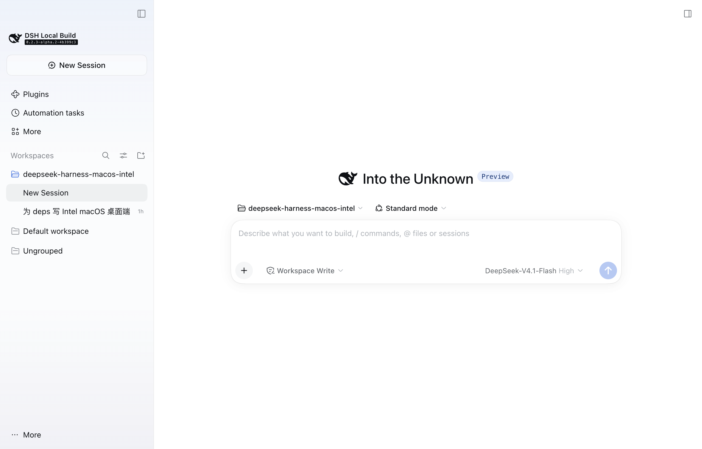

# DeepSeek Harness 桌面端 · Intel (x86_64) macOS 构建

官网下载页目前只给 macOS 提供 Apple Silicon 版（`dsh-latest-macos-arm64.dmg`），[下载页](https://www.deepseek.com/download/) 上也只有“Apple 芯片、macOS 13 或更高版本”这一项。但官方仓库里 **Intel 目标本身是存在的**：

- `apps/desktop/package.json` 提供 `package:mac:x64` / `package:mac:x64:unsigned`
- CI 里有专门的 [macos-intel-package.yml](https://github.com/deepseek-ai/deepseek-harness/blob/master/.github/workflows/macos-intel-package.yml)，在 Apple Silicon runner 上用 Rosetta 打 x64 包
- [打包指南](https://github.com/deepseek-ai/deepseek-harness/blob/master/apps/desktop/packaging/README.md) 明确写了 “The macOS x64 command runs on Intel macOS or Apple Silicon with Rosetta”

所以不需要“另写”一个壳：直接把官方源码按 mac-x64 目标编译即可。本目录就是在这台 Intel Mac（macOS 14.7.4，x86_64）上实际构建、打包并启动验证过的结果。

## 交付物

| 文件 | 说明 |
|---|---|
| [`dist/deepseek-harness-0.2.3-alpha.2-mac-x64-unsigned.dmg`](dist/deepseek-harness-0.2.3-alpha.2-mac-x64-unsigned.dmg) | Intel 版安装镜像（288 MB） |
| [`dist/SHA256SUMS`](dist/SHA256SUMS) | DMG 校验和 |
| [`build-intel.sh`](build-intel.sh) | 一键复现构建 |
| [`prefetch-runtime.sh`](prefetch-runtime.sh) | 预取 GitHub / PyPI 运行时归档（规避 Node fetch 超时） |
| `docs/screenshots/` | 启动后的欢迎页与工作区截图 |

另外已把应用装到了 **`/Applications/DeepSeek Harness.app`**，可以直接从启动台打开；不需要的话删掉即可。

构建信息：

```text
产品版本   0.2.3-alpha.2（commit 4b399c3）
架构       x86_64（Mach-O thin，非通用二进制）
签名       ad-hoc（hardened runtime，无 Developer ID / 无公证）
应用大小   1.1 GB（安装后）
DMG 大小   288 MB
SHA-256    a8c1b4c2dfab9fc45539e40b5c0468d40fa906e8ff0c6f0901087d829beb37b5
```

## 验证记录

构建流程自带的检查全部通过，随后又做了真机启动验证：

- `runtime payload` 冒烟：`{"node":"24.22.3","platform":"darwin","arch":"x64","koffi":true,"sharp":true,"html":true,"pty":true,"pnpm":true,"grep":true,"glob":true}` —— 包含 node-pty 的真实 PTY 分配、原生模块加载和自带 pnpm。
- 打包内 Office 运行时：Office 技能加载、DOCX/XLSX/PPTX 转 PDF、图片渲染、格式转换与重算全部通过。
- 内置 CLI：离线插件安装、删除通过。
- DMG 挂载 → 拷贝到 `/Applications` → 启动：欢迎页正常渲染；进入工作区后能看到这台机器上原有的工作区与会话（`deepseek-harness-macos-intel`、当前这条会话），模型选择器显示 `DeepSeek-V4.1-Flash High`。
- `codesign -dv`：`Identifier=com.deepseek.harness`、`Format=app bundle with Mach-O thin (x86_64)`、`Signature=adhoc`。

截图：




## 安装与首次启动

1. 双击 `dist/deepseek-harness-0.2.3-alpha.2-mac-x64-unsigned.dmg`，把 `DeepSeek Harness.app` 拖进“应用程序”。
2. 因为这是本地未公证构建，如果系统提示“无法验证开发者”，在应用上右键 → **打开**，或执行：

   ```sh
   xattr -dr com.apple.quarantine "/Applications/DeepSeek Harness.app"
   ```

3. 桌面端使用独立的 `$DSH_HOME/profiles/desktop`，但**会话、工作区、凭据等产品数据与 Web 版共享**（本机启动时直接读到了 Web 版的会话和模型配置）。如果没有可用凭据，会先显示登录 / 填 API Key 的欢迎页。

## 已知限制

- **未签名、未公证**：不具备 Apple Developer ID，`spctl` 会拒绝；只适合自用。要分发给别人需要自行准备证书和公证凭据，用 `pnpm run package:desktop:mac:x64`（签名模式）重打。
- **没有自动更新**：本地 unsigned 构建按官方设计省略了 update feed，应用内的“检查更新”不可用；升级需重新构建。
- **品牌显示为 “DSH Local Build”**：官方对未签名 / 本地构建的统一标记，功能不受影响（应用名仍是 DeepSeek Harness）。
- **不是通用二进制**：这只是 x86_64 版本，Apple Silicon 机器仍应用官网的 arm64 包（或 Rosetta 运行此包）。
- 版本比 npm 上的 `@deepseek-ai/dsh@0.2.2-rc.5` 新一代（`0.2.3-alpha.2`，即当前 master），桌面端自带配套运行时，和本机 npm CLI 的版本互不影响。

## 复现构建

```sh
cd /Users/xusm/Documents/GitHub/deepseek-harness-macos-intel
./build-intel.sh            # 完整构建；已有 DMG 时直接复用，FORCE=1 强制重打
./build-intel.sh --check    # 只校验打包配置与工具链
```

脚本做的事情与本次手工构建完全一致：

1. 下载 **Node 24.22.3** 到 `toolchain/`（仓库要求 `^24.22.3 || >=26.13.1`，系统自带的 25.x 不满足）。
2. 安装 **pnpm 11.28.5**（仓库 `packageManager` 固定版本）。
3. `git clone` 官方仓库到 `src/`（默认 `master`）。
4. `pnpm install --frozen-lockfile`（约 1.3 GB，首次 17 分钟）。
5. `prefetch-runtime.sh` 用 curl 预取运行时归档（Python 3.12.14 standalone、Node、14 个 wheel）到 `.caches/desktop-package/downloads/`，按 lock 文件里的 SHA-256 校验。
6. `pnpm run package:desktop:mac:x64:unsigned` → DMG，并复制到 `dist/`。

两个环境坑，脚本已处理：

- **GitHub release 资源**：本机 Node 的 `fetch()` 读 `github.com` / `files.pythonhosted.org` 会 `read ETIMEDOUT`（curl 正常）。所以 Python、Node、wheel 都由 curl 预先落到缓存；Electron 走 `ELECTRON_MIRROR=https://npmmirror.com/mirrors/electron/`（校验和一致）。非国内网络可覆盖 `ELECTRON_MIRROR`。
- **`/dev/ptmx`**：运行时冒烟测试会通过 node-pty 真正分配 PTY，在受限沙箱（例如 DSH 的 workspace-write seatbelt）里会报 `posix_openpt failed: Operation not permitted`。请在普通终端里跑构建。

所有下载物、pnpm store、Electron 缓存、构建中间产物都落在本目录，不污染全局环境：

```text
toolchain/         Node 24.22.3 + pnpm 11.28.5
.caches/           pnpm store、Electron/运行时归档（约 1.3 GB）
src/               官方源码 checkout + node_modules + 构建输出（约 5.5 GB）
dist/              交付的 DMG
```

## 清理

```sh
# 卸载应用与桌面端数据（可选）
rm -rf "/Applications/DeepSeek Harness.app"
rm -rf "$HOME/Library/Application Support/@deepseek-ai/dsh-desktop"
rm -rf "$HOME/.dsh/profiles/desktop"

# 删除本目录的构建环境（保留 dist/ 里的 DMG 即可）
rm -rf toolchain .caches src
```
